# Fluid UI

**English** · [简体中文](README.zh-CN.md)

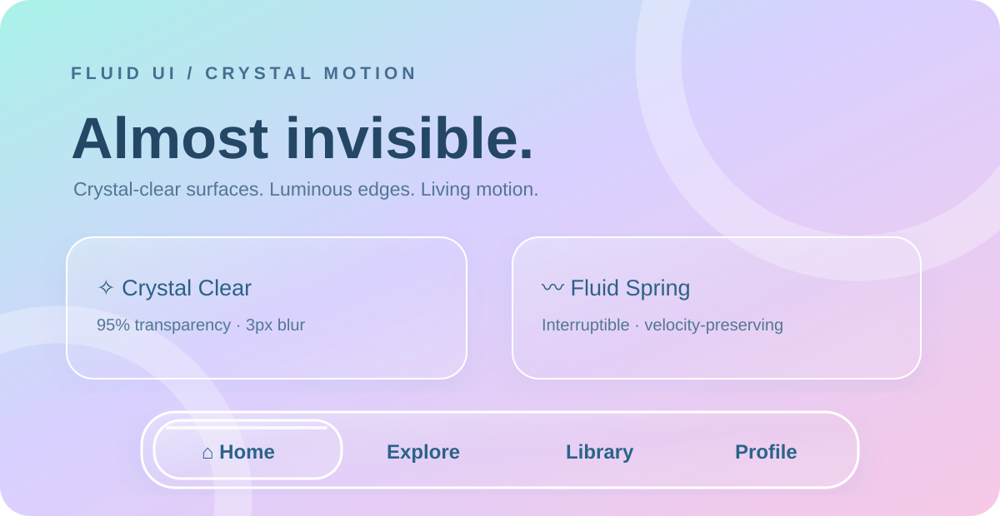

> **Visual concept illustration.** The image communicates the Crystal Motion material direction; use the [live Web demo](demo/crystal-motion/index.html) to inspect actual interaction and rendering.

**Design interfaces that feel alive.** Fluid UI is a reusable Agent Skill for Codex and other coding agents. It combines deliberate UI design, expressive yet accessible motion, and reliable state-driven interactions. Its optional **Crystal Motion** preset brings almost-clear liquid glass, bright optical edges, soft Aurora backgrounds, and interruptible spring motion to the full 20-pattern design guidance.

**[View all 20 illustrated interactions](docs/SHOWCASE.md)** · **[Explore the interactive demo](demo/crystal-motion/index.html)** · **[Crystal Motion specification](skills/fluid-ui/references/presets/crystal-motion.md)** · **[中文介绍](README.zh-CN.md)**


Fluid UI is an Agent Skill for deliberate UI design and reliable interaction states. It helps coding agents preserve an existing design system, select an appropriate visual style, and validate changes with proportionate motion.

**Skill version 1.2.0 · MIT · Codex is the primary tested host.**

## Crystal Motion — crystal-clear glass and fluid interaction

The new **Crystal Motion** Glass preset adds nearly transparent optical surfaces, fine luminous edge highlights, low blur, and velocity-preserving, interruptible spring motion. Its [implementation contract](skills/fluid-ui/references/presets/crystal-motion.md) maps the material and motion language across **all 20 interaction patterns**, while retaining the existing four styles and Liquid Glass v5.

- [Runnable Crystal Motion navigation demo](demo/crystal-motion/index.html) — interactive Web reference, not a 20-component library.
- [Crystal Motion config example](skills/fluid-ui/assets/crystal-motion.config.json)
- [Rollout and verification checklist](skills/fluid-ui/references/crystal-motion-rollout.md)

Use `style: "Glass", preset: "Crystal Motion"` when explicitly requested. The 20-pattern guidance is available; this is not a claim that all 20 patterns have separately implemented and tested Crystal Motion components. See the verification checklist for current limits. Version 1.2.0 is staged for release, pending successful automated checks and release packaging.

## All 20 interactions — illustrated showcase

Every pattern has its **own image**, a concise explanation, and a link to the underlying implementation contract. The images are conceptual SVG illustrations, **not screenshots of 20 verified components**. The [verification matrix](docs/SHOWCASE.md) records what has actually been tested.

### 01. Theme Reveal

[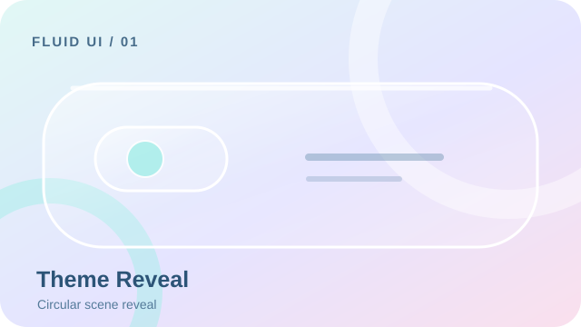](skills/fluid-ui/references/patterns/theme-reveal.md)

Circular transition between complete light and dark scenes. [Specification](skills/fluid-ui/references/patterns/theme-reveal.md) · [Verification](docs/SHOWCASE.md)

### 02. Floating Timer Pill

[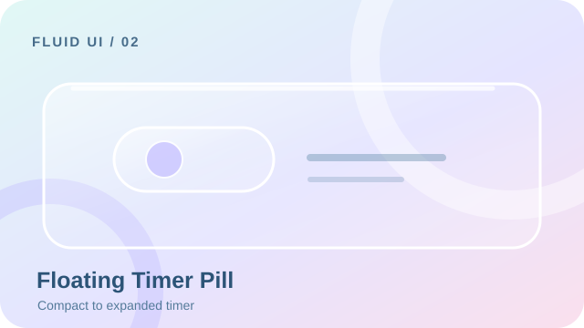](skills/fluid-ui/references/patterns/floating-timer-pill.md)

A compact timer that expands without interrupting timekeeping. [Specification](skills/fluid-ui/references/patterns/floating-timer-pill.md) · [Verification](docs/SHOWCASE.md)

### 03. Adaptive Step Sheet

[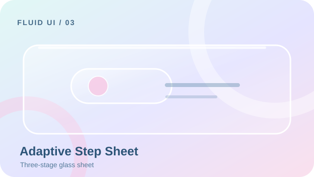](skills/fluid-ui/references/patterns/adaptive-step-sheet.md)

A multi-step sheet with coordinated height and content transitions. [Specification](skills/fluid-ui/references/patterns/adaptive-step-sheet.md) · [Verification](docs/SHOWCASE.md)

### 04. Fluid Bottom Navigation

[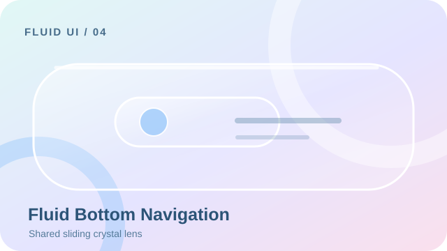](skills/fluid-ui/references/patterns/fluid-bottom-navigation.md)

One shared crystal lens moves and reshapes across tabs. [Specification](skills/fluid-ui/references/patterns/fluid-bottom-navigation.md) · [Verification](docs/SHOWCASE.md)

### 05. Scroll-aware FAB

[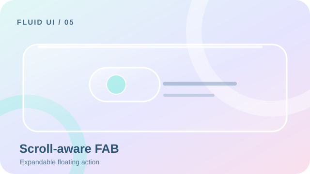](skills/fluid-ui/references/patterns/scroll-aware-fab.md)

A floating action button that contracts and expands with scrolling. [Specification](skills/fluid-ui/references/patterns/scroll-aware-fab.md) · [Verification](docs/SHOWCASE.md)

### 06. Copy Success Feedback

[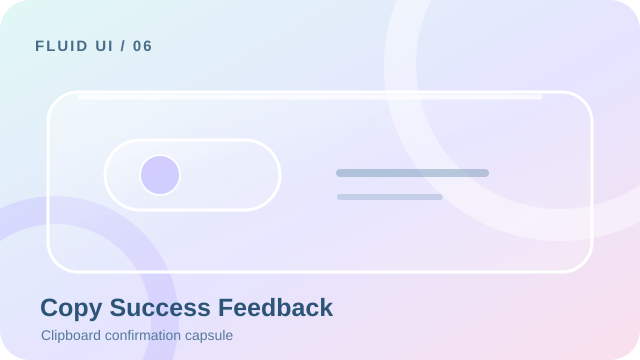](skills/fluid-ui/references/patterns/copy-success-feedback.md)

Clipboard feedback that changes shape only after success. [Specification](skills/fluid-ui/references/patterns/copy-success-feedback.md) · [Verification](docs/SHOWCASE.md)

### 07. Animated Form Validation

[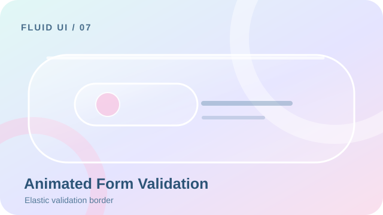](skills/fluid-ui/references/patterns/animated-form-validation.md)

Validation errors unfold with clear accessible feedback. [Specification](skills/fluid-ui/references/patterns/animated-form-validation.md) · [Verification](docs/SHOWCASE.md)

### 08. Anchored Dropdown

[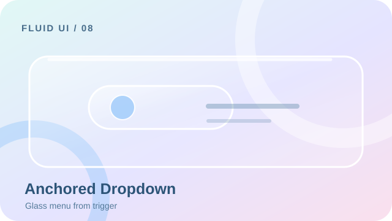](skills/fluid-ui/references/patterns/anchored-dropdown.md)

A menu that emerges from its trigger and restores focus. [Specification](skills/fluid-ui/references/patterns/anchored-dropdown.md) · [Verification](docs/SHOWCASE.md)

### 09. Shared Element Transition

[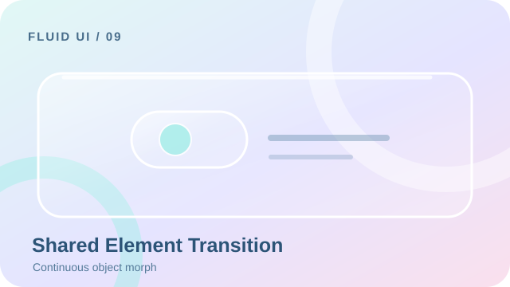](skills/fluid-ui/references/patterns/shared-element-transition.md)

A visual element retains identity between screens. [Specification](skills/fluid-ui/references/patterns/shared-element-transition.md) · [Verification](docs/SHOWCASE.md)

### 10. Expandable Search Field

[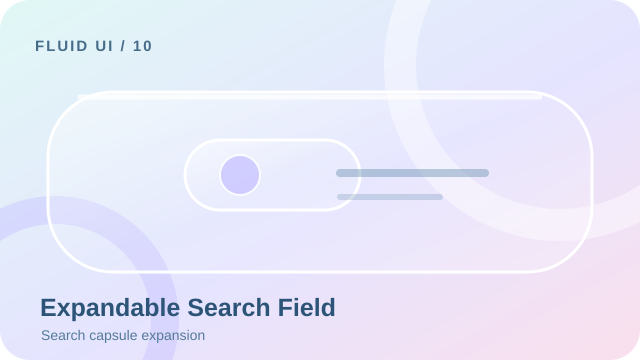](skills/fluid-ui/references/patterns/expandable-search-field.md)

A compact search control expands into an editable field. [Specification](skills/fluid-ui/references/patterns/expandable-search-field.md) · [Verification](docs/SHOWCASE.md)

### 11. Elastic Pull to Refresh

[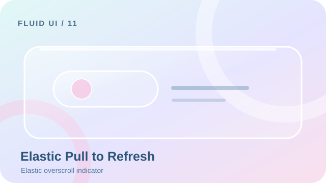](skills/fluid-ui/references/patterns/elastic-pull-to-refresh.md)

A gesture-driven refresh indicator with elastic resistance. [Specification](skills/fluid-ui/references/patterns/elastic-pull-to-refresh.md) · [Verification](docs/SHOWCASE.md)

### 12. Swipe Actions

[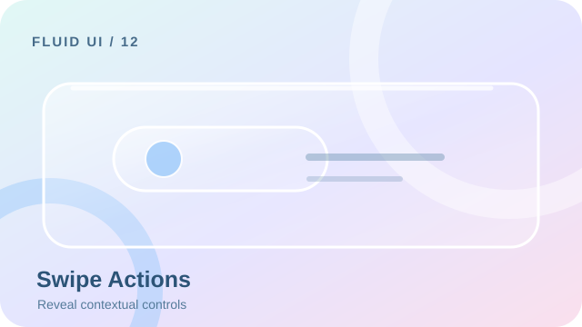](skills/fluid-ui/references/patterns/swipe-actions.md)

Contextual actions revealed through controlled swiping. [Specification](skills/fluid-ui/references/patterns/swipe-actions.md) · [Verification](docs/SHOWCASE.md)

### 13. Skeleton Content Transition

[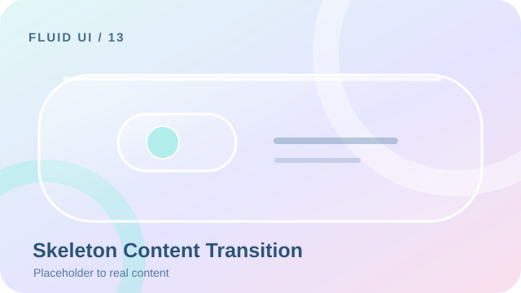](skills/fluid-ui/references/patterns/skeleton-content-transition.md)

Loading placeholders transition into stable content. [Specification](skills/fluid-ui/references/patterns/skeleton-content-transition.md) · [Verification](docs/SHOWCASE.md)

### 14. Reaction Microinteraction

[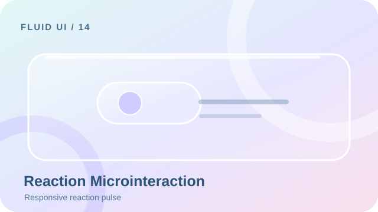](skills/fluid-ui/references/patterns/reaction-microinteraction.md)

Small responsive feedback for repeated reactions. [Specification](skills/fluid-ui/references/patterns/reaction-microinteraction.md) · [Verification](docs/SHOWCASE.md)

### 15. Async Button States

[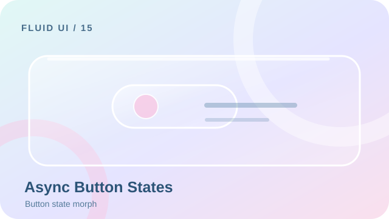](skills/fluid-ui/references/patterns/async-button-states.md)

A button morphs through loading, success, and failure. [Specification](skills/fluid-ui/references/patterns/async-button-states.md) · [Verification](docs/SHOWCASE.md)

### 16. Immersive Image Preview

[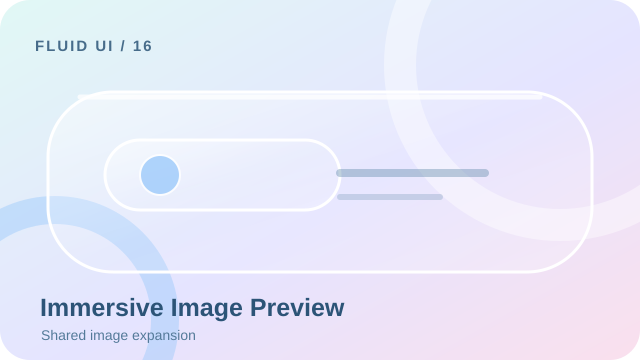](skills/fluid-ui/references/patterns/immersive-image-preview.md)

A shared image expands into a focused preview. [Specification](skills/fluid-ui/references/patterns/immersive-image-preview.md) · [Verification](docs/SHOWCASE.md)

### 17. Predictive Back Transition

[](skills/fluid-ui/references/patterns/predictive-back-transition.md)

Screen motion follows the system back gesture. [Specification](skills/fluid-ui/references/patterns/predictive-back-transition.md) · [Verification](docs/SHOWCASE.md)

### 18. Empty and Error States

[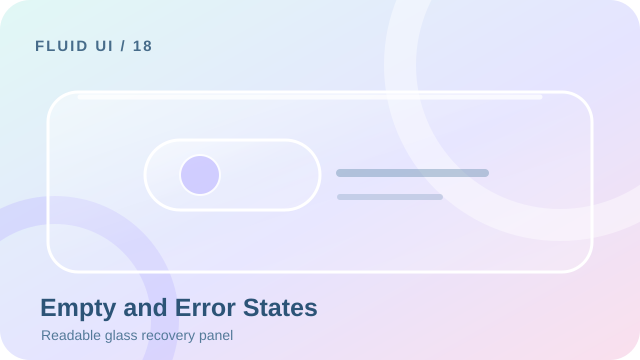](skills/fluid-ui/references/patterns/empty-and-error-states.md)

Clear recovery actions inside restrained glass surfaces. [Specification](skills/fluid-ui/references/patterns/empty-and-error-states.md) · [Verification](docs/SHOWCASE.md)

### 19. Expandable Content Card

[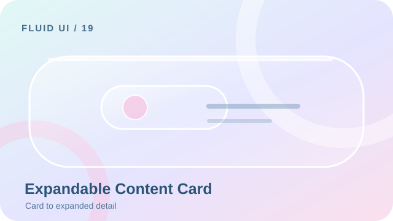](skills/fluid-ui/references/patterns/expandable-content-card.md)

A card grows into details while preserving content continuity. [Specification](skills/fluid-ui/references/patterns/expandable-content-card.md) · [Verification](docs/SHOWCASE.md)

### 20. Collapsing Top App Bar

[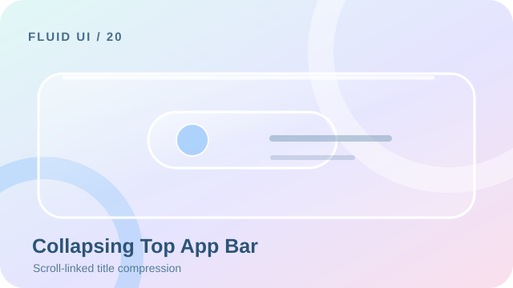](skills/fluid-ui/references/patterns/collapsing-top-app-bar.md)

A title bar compresses smoothly as content scrolls. [Specification](skills/fluid-ui/references/patterns/collapsing-top-app-bar.md) · [Verification](docs/SHOWCASE.md)

## Liquid Glass v5

Version 1.1.0 adds an **opt-in Liquid Glass preset under Glass**, preserving the original four styles and twenty patterns. Design v5 and Skill version 1.1.0 are different version axes. The approved [handoff](fluid-ui-v5-handoff/ACCEPTANCE.md) and [runnable reference](fluid-ui-v5-handoff/index.html) are preserved without modification. The [engineering demo](demo/liquid-glass/index.html) adds keyboard, focus, interruption, real clipboard failure and responsive safeguards while retaining all eight approved morphing interactions.

Run `npm run dev`, then open `http://127.0.0.1:4173/demo/liquid-glass/`. Use `style: "Glass", preset: "Liquid Glass"`; Auto will not force it on unrelated UI work. See [configuration](skills/fluid-ui/assets/liquid-glass.config.json), [morphing contract](skills/fluid-ui/references/morphing.md), and [1.1.0 verification](docs/verification/v1.1.0/report.md). Native/mobile equivalence is unverified. The three appearance menu items show selection state, not three separate material engines.

## Capabilities

- Four style references: Glass, Material 3, Minimal, Tech.
- Auto, Preset, Hybrid selection; independent Subtle, Balanced, Expressive intensity.
- Twenty on-demand [interaction patterns](skills/fluid-ui/references/patterns.md), each with states, interruption, accessibility, performance, platform adaptation and acceptance criteria.
- Web, Android Compose, Flutter and React Native implementation guidance. Guidance is not a compiled component library.
- Versioned project configuration, native-first implementation and minimum change scope.
- Runnable Web interaction lab with failure, cancellation, form recovery, theme switching, navigation, sheet and expandable content.

## Install

The repository is the authoritative distribution source: [ZZM112451/fluid-ui-skill](https://github.com/ZZM112451/fluid-ui-skill). Publication state and evidence are tracked in [verification](docs/verification/report.md); a URL alone does not establish a published release.

Clone the repository, inspect the scripts, then run with Node.js 22+:

```sh
git clone https://github.com/ZZM112451/fluid-ui-skill.git
cd fluid-ui-skill
node scripts/manage.mjs install --agent codex
```

The current Codex user target is `~/.agents/skills/fluid-ui`. Project installs use `--project <directory>`. A GitHub source ZIP is a source checkout; it is different from the versioned [Release package](https://github.com/ZZM112451/fluid-ui-skill/releases). Release installation requires a fixed version and its SHA256. Do not run downloaded remote scripts blindly.

See [Codex](docs/install/codex.md), [Claude Code](docs/install/claude.md), [Cursor](docs/install/cursor.md), [Gemini CLI](docs/install/gemini.md), and [distribution and rollback](docs/install/distribution.md). Only the tested host is described as verified; see the [compatibility matrix](docs/compatibility.md).

## Use in Codex

```text
使用 $fluid-ui 优化当前表单。保留已有设计系统，只改善错误、加载、取消和恢复反馈；实施后运行相关测试。
```

```text
使用 $fluid-ui 为 Web 设置页采用 Glass 和 Subtle，保留业务与路由，验证明暗、小屏、键盘和减少动态效果。
```

```text
使用 $fluid-ui 审查 Compose 底部导航与分步弹窗，优先 Material 3 原生能力；没有设备时明确区分编译与真机未验证。
```

## Architecture

`skills/fluid-ui/` is the installable root. `SKILL.md` routes to focused style, pattern, platform and verification references. `agents/openai.yaml` isolates Codex metadata. `assets/fluid-ui.config.json` records schema and fixed Skill version. `scripts/` contains optional config checks; core instructions do not depend on a particular host tool.

The repository additionally contains `demo/`, safe local management scripts, PowerShell/bash Release installers, tests, CI and evidence. There are no Web demo runtime dependencies. Development tools are locked in package-lock.json.

## Run and test

```sh
npm ci
npm run dev
# http://127.0.0.1:4173/demo/
npm test
npm run validate
npx playwright install chromium
npm run test:web
npm audit
npm run scan
npm run package
```

For an existing local Chromium, set `FLUID_CHROMIUM` to its executable. The [test report](docs/verification/report.md) distinguishes structure, execution, visual inspection, host invocation and unverified platforms. [Comparison study](docs/verification/comparison.md) retains five baseline/enhanced tasks and a representative existing-project trial; it does not promise a universal improvement.

## Limits and contributions

The twenty patterns are guidance; the demo implements a subset. Native Android/Flutter/RN and other agents require their own environments. Automated accessibility checks do not replace screen readers and human review. Headless browser timings are not device GPU guarantees. Explicit invocation does not prove automatic trigger reliability.

Contributions should include a focused change, reproducible tests, evidence and limitations. Preserve state correctness, existing tokens and user files. Use SemVer; update [CHANGELOG](CHANGELOG.md) and migration notes for breaking changes. Updates are manual and conflict protected, never automatic replacements.

## License

[MIT](LICENSE), copyright 2026 ZZM112451. See [third-party notices](THIRD_PARTY_NOTICES.md).
