# Fluid UI

**[English (default)](README.md)** · 简体中文

> **图片是视觉概念示意，不是浏览器实际截图。** 真实交互和材质渲染请运行 [Crystal Motion Web 演示](demo/crystal-motion/index.html)。

**让界面拥有生命力。** Fluid UI 是面向 Codex 等编程 Agent 的 UI 设计与交互增强 Skill。通过统一的状态驱动交互、可中断弹簧运动、无障碍与性能规范，让界面更清透、更连贯、更可靠。Crystal Motion 作为可选预设，为全部 20 种交互提供高透亮水晶玻璃的材质与运动指导。

[交互演示](demo/crystal-motion/index.html) · [Crystal Motion 完整规范](skills/fluid-ui/references/presets/crystal-motion.md) · [20 种模式](skills/fluid-ui/references/patterns.md)

## Crystal Motion 全面规范

- **视觉**：近乎透明的玻璃本体、明亮纤细的高光边缘、低模糊与 Aurora 背景。
- **动效**：连续共享形变、速度继承、手势追踪和快速反向中断。
- **覆盖**：全部 20 种交互模式均有适配指导；现有可运行参考仅覆盖部分组件，不能声称全部已完成工程实现。
- **兼容**：保留 Liquid Glass v5、原四种风格与既有项目设计系统；不强制 Auto 玻璃化。

面向编程 Agent 的 UI 设计与交互增强 Skill。优先保留项目既有设计系统与业务，只在有价值的位置使用动效。名称 fluid-ui，版本 1.2.0（候选发布），许可证 MIT。

## 全部 20 种交互 · 逐项图片展示

每种交互都有**独立图片、功能说明与实现规范入口**。这些 SVG 为概念效果示意，**不是 20 种组件均已验证的运行截图**。实际测试情况见[验证状态表](docs/SHOWCASE.zh-CN.md)。

### 01. 主题扩散 · Theme Reveal

完整明暗场景的圆形扩散切换。 [交互规范](skills/fluid-ui/references/patterns/theme-reveal.md) · [验收状态](docs/SHOWCASE.zh-CN.md)

### 02. 悬浮计时胶囊 · Floating Timer Pill

计时不中断的可展开胶囊。 [交互规范](skills/fluid-ui/references/patterns/floating-timer-pill.md) · [验收状态](docs/SHOWCASE.zh-CN.md)

### 03. 自适应分步弹窗 · Adaptive Step Sheet

高度与内容协同变化的多步骤弹窗。 [交互规范](skills/fluid-ui/references/patterns/adaptive-step-sheet.md) · [验收状态](docs/SHOWCASE.zh-CN.md)

### 04. 流体底部导航 · Fluid Bottom Navigation

同一水晶镜片在导航项之间连续移动形变。 [交互规范](skills/fluid-ui/references/patterns/fluid-bottom-navigation.md) · [验收状态](docs/SHOWCASE.zh-CN.md)

### 05. 随滚动变化的悬浮按钮 · Scroll-aware FAB

[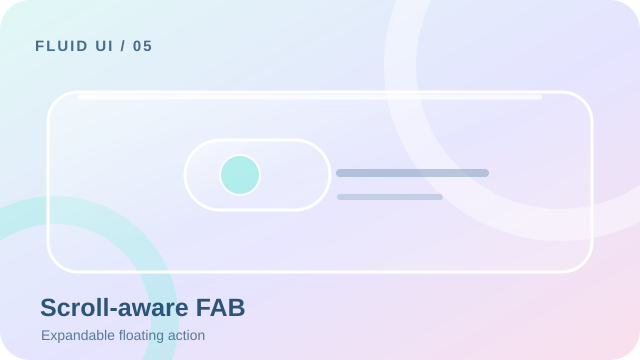](skills/fluid-ui/references/patterns/scroll-aware-fab.md)

随滚动收缩和展开的操作按钮。 [交互规范](skills/fluid-ui/references/patterns/scroll-aware-fab.md) · [验收状态](docs/SHOWCASE.zh-CN.md)

### 06. 复制成功反馈 · Copy Success Feedback

[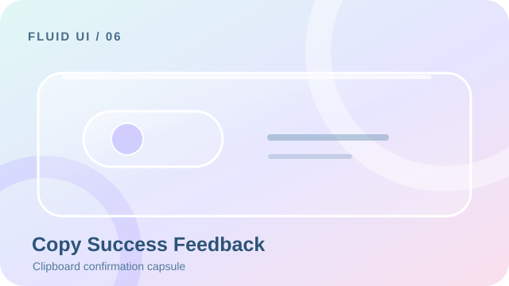](skills/fluid-ui/references/patterns/copy-success-feedback.md)

真正复制成功后才改变形态的反馈。 [交互规范](skills/fluid-ui/references/patterns/copy-success-feedback.md) · [验收状态](docs/SHOWCASE.zh-CN.md)

### 07. 动态表单校验 · Animated Form Validation

[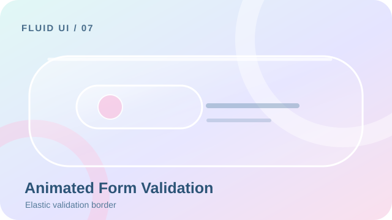](skills/fluid-ui/references/patterns/animated-form-validation.md)

错误提示平滑展开且保持无障碍语义。 [交互规范](skills/fluid-ui/references/patterns/animated-form-validation.md) · [验收状态](docs/SHOWCASE.zh-CN.md)

### 08. 锚定下拉菜单 · Anchored Dropdown

[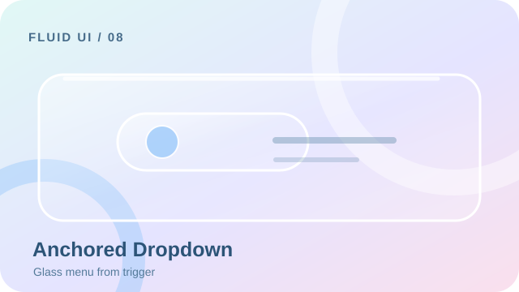](skills/fluid-ui/references/patterns/anchored-dropdown.md)

从触发器延展并正确管理焦点的菜单。 [交互规范](skills/fluid-ui/references/patterns/anchored-dropdown.md) · [验收状态](docs/SHOWCASE.zh-CN.md)

### 09. 共享元素过渡 · Shared Element Transition

[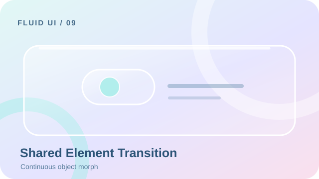](skills/fluid-ui/references/patterns/shared-element-transition.md)

同一视觉元素跨页面保持连续身份。 [交互规范](skills/fluid-ui/references/patterns/shared-element-transition.md) · [验收状态](docs/SHOWCASE.zh-CN.md)

### 10. 可展开搜索框 · Expandable Search Field

[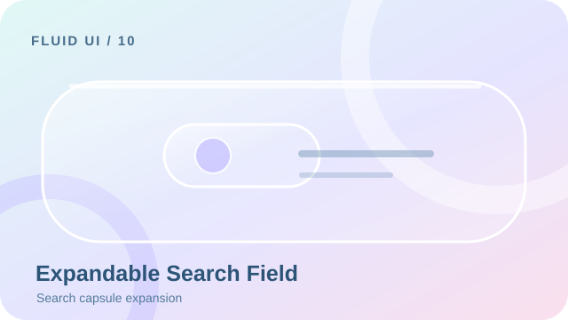](skills/fluid-ui/references/patterns/expandable-search-field.md)

紧凑搜索控件展开为可输入的搜索框。 [交互规范](skills/fluid-ui/references/patterns/expandable-search-field.md) · [验收状态](docs/SHOWCASE.zh-CN.md)

### 11. 弹性下拉刷新 · Elastic Pull to Refresh

[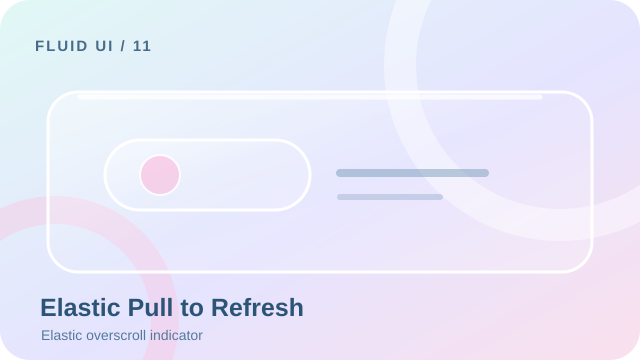](skills/fluid-ui/references/patterns/elastic-pull-to-refresh.md)

具有弹性阻尼的手势刷新指示器。 [交互规范](skills/fluid-ui/references/patterns/elastic-pull-to-refresh.md) · [验收状态](docs/SHOWCASE.zh-CN.md)

### 12. 滑动操作 · Swipe Actions

[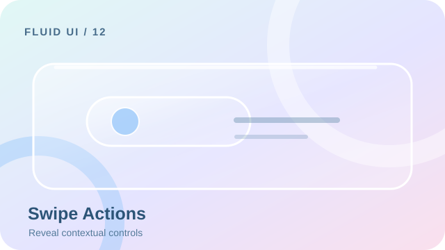](skills/fluid-ui/references/patterns/swipe-actions.md)

通过可控滑动露出上下文操作。 [交互规范](skills/fluid-ui/references/patterns/swipe-actions.md) · [验收状态](docs/SHOWCASE.zh-CN.md)

### 13. 骨架屏内容过渡 · Skeleton Content Transition

[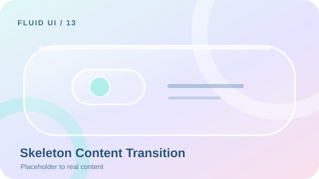](skills/fluid-ui/references/patterns/skeleton-content-transition.md)

加载占位平滑过渡到实际内容。 [交互规范](skills/fluid-ui/references/patterns/skeleton-content-transition.md) · [验收状态](docs/SHOWCASE.zh-CN.md)

### 14. 表态微交互 · Reaction Microinteraction

[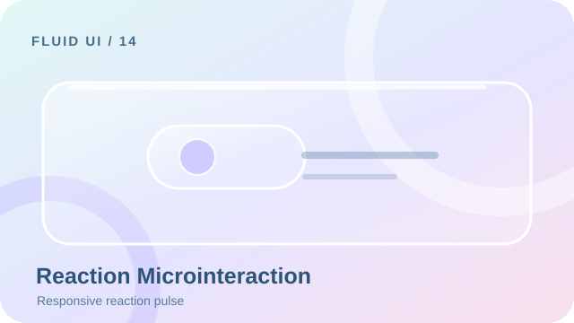](skills/fluid-ui/references/patterns/reaction-microinteraction.md)

支持连续操作的轻量表态反馈。 [交互规范](skills/fluid-ui/references/patterns/reaction-microinteraction.md) · [验收状态](docs/SHOWCASE.zh-CN.md)

### 15. 异步按钮状态 · Async Button States

[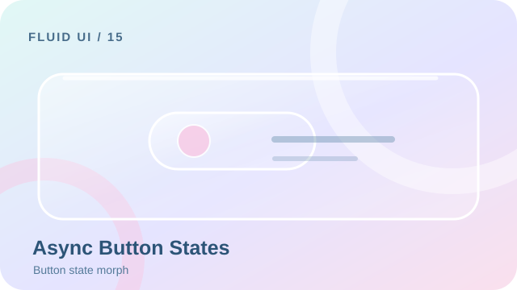](skills/fluid-ui/references/patterns/async-button-states.md)

按钮在加载、成功和失败状态间连续变换。 [交互规范](skills/fluid-ui/references/patterns/async-button-states.md) · [验收状态](docs/SHOWCASE.zh-CN.md)

### 16. 沉浸式图片预览 · Immersive Image Preview

[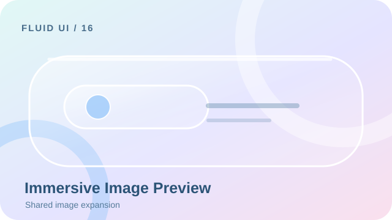](skills/fluid-ui/references/patterns/immersive-image-preview.md)

图片连续放大进入沉浸式预览。 [交互规范](skills/fluid-ui/references/patterns/immersive-image-preview.md) · [验收状态](docs/SHOWCASE.zh-CN.md)

### 17. 预测式返回过渡 · Predictive Back Transition

页面运动跟随系统返回手势。 [交互规范](skills/fluid-ui/references/patterns/predictive-back-transition.md) · [验收状态](docs/SHOWCASE.zh-CN.md)

### 18. 空状态与错误状态 · Empty and Error States

[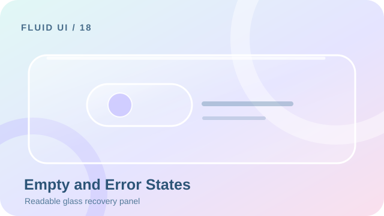](skills/fluid-ui/references/patterns/empty-and-error-states.md)

在克制的玻璃表面提供清晰恢复操作。 [交互规范](skills/fluid-ui/references/patterns/empty-and-error-states.md) · [验收状态](docs/SHOWCASE.zh-CN.md)

### 19. 可展开内容卡片 · Expandable Content Card

[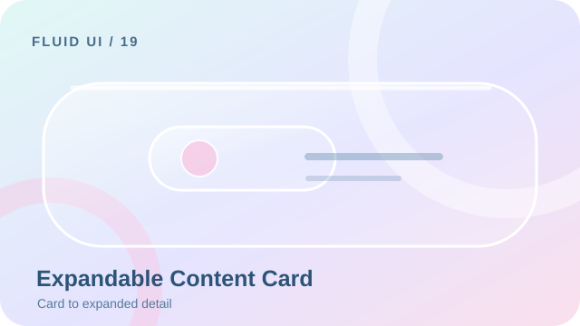](skills/fluid-ui/references/patterns/expandable-content-card.md)

卡片连续扩展为详情容器。 [交互规范](skills/fluid-ui/references/patterns/expandable-content-card.md) · [验收状态](docs/SHOWCASE.zh-CN.md)

### 20. 折叠顶部应用栏 · Collapsing Top App Bar

[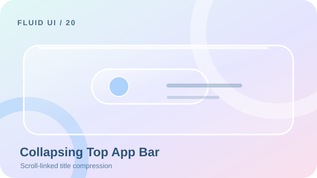](skills/fluid-ui/references/patterns/collapsing-top-app-bar.md)

顶部标题栏随内容滚动平滑压缩。 [交互规范](skills/fluid-ui/references/patterns/collapsing-top-app-bar.md) · [验收状态](docs/SHOWCASE.zh-CN.md)

## 已确认的 Liquid Glass v5
设计版本 v5 对应兼容增强版 Skill 1.1.0。原四风格、20 模式和旧配置保留；Liquid Glass 仅作为 Glass 的显式预设，不自动覆盖现有项目。项目配置设置 `style: "Glass", preset: "Liquid Glass"`，强度独立。

[原始交付](fluid-ui-v5-handoff/ACCEPTANCE.md) · [工程示例](demo/liquid-glass/index.html) · [本版验证](docs/verification/v1.1.0/report.md)。启动 `npm run dev` 后访问 `http://127.0.0.1:4173/demo/liquid-glass/`。八种交互保留连续形变、完整双场景主题扩散、独立计时和三步滑动，补充失败/竞态、键盘、焦点与减少动态效果。三项外观菜单只示意选择状态，原生平台仍未验证。

示例：`使用 $fluid-ui 按已确认的 Liquid Glass v5 合约实现页面，保留八交互的持续节点与形变，不以淡入淡出替代；先运行原型，再验证中间态、失败和取消。`

## 能力与边界
四风格 Glass、Material 3、Minimal、Tech；三模式 Auto/Preset/Hybrid；独立三档强度 Subtle/Balanced/Expressive。[20 种模式](skills/fluid-ui/references/patterns.md) 按需读取，涵盖状态、动画参数、中断、无障碍、性能、平台与验收。

提供 Web、Compose、Flutter、React Native 指导，不建立庞大跨平台组件库。Web 演示只实现部分模式，不能据此声称四平台已编译或所有 Agent 已兼容。

## 安装与调用
Node.js 22+，检出本仓库后运行 `node scripts/manage.mjs install --agent codex`。默认用户目录为 `~/.agents/skills/fluid-ui`。项目级加 `--project <项目目录>`。同版本相同内容重复安装不改文件；已有修改或版本变化拒绝覆盖，必须比较、备份并明确确认。

在 Codex 输入 `使用 $fluid-ui 优化当前界面，保留现有设计系统和业务；先给出风格与动效依据，再实施最小范围修改并验证。` 自动触发受宿主描述预算与选择影响，实际调用结果见报告。若技能列表未刷新，重启 Codex。

[各 Agent 安装](docs/compatibility.md) · [版本固定、更新与回滚](docs/install/distribution.md) · [真实验证](docs/verification/report.md) · [效果对照](docs/verification/comparison.md)

## 开发与测试
`npm ci` 安装开发依赖，`npm run dev` 后打开 `http://127.0.0.1:4173/demo/`。`npm test` 测配置与异步、安装安全；`npm run test:web` 跑浏览器；`npm run validate` 检查结构链接；`npm run scan` 做替代敏感信息与 Git 历史规则扫描；`npm run package` 生成 ZIP 与 SHA256。

详细架构、五类使用案例、贡献说明与限制见 [主说明](README.md)。更新遵循 SemVer、CHANGELOG 和迁移说明，不自动替换用户技能。请为贡献附实际测试证据，保持最小改动。

[MIT LICENSE](LICENSE) 使用用户确认的版权名 ZZM112451，年份 2026。无外部字体、图标、图片与商业组件；第三方开发依赖见 [授权记录](THIRD_PARTY_NOTICES.md)。
