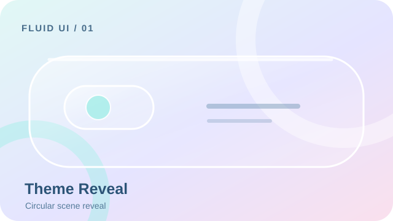
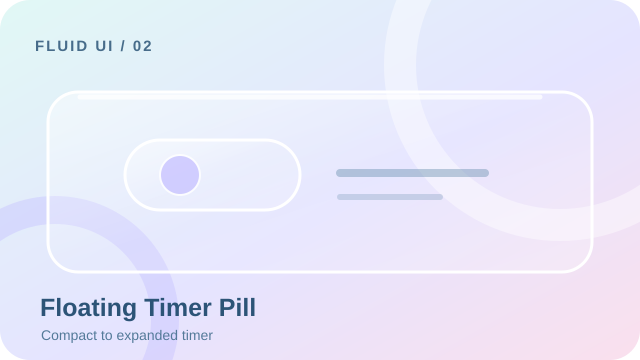
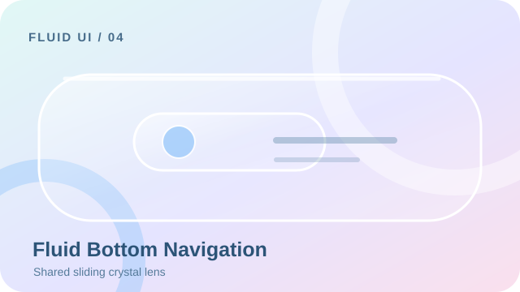
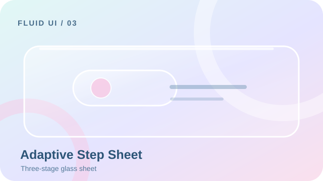

# Fluid UI

[English (default)](README.md) · **简体中文**


> **图片是视觉概念示意，不是浏览器实际截图。** 真实交互和材质渲染请看 [在线演示站](https://zzm112451.github.io/fluid-ui-skill/) 或本地运行 [Crystal Motion Web 演示](demo/crystal-motion/index.html)。

**让界面拥有生命力。** Fluid UI 是面向 Codex 等编程 Agent 的可复用 UI 设计与交互增强 Skill，把克制的界面设计、有表现力但仍然无障碍的运动，以及可靠的状态驱动交互组合在一起。可选的 **Crystal Motion** 预设为全部 20 种交互模式提供近乎透明的液态玻璃、明亮的光学边缘、柔和 Aurora 背景与可中断的弹簧运动。

**在线演示**：<https://zzm112451.github.io/fluid-ui-skill/>（[交互实验台](https://zzm112451.github.io/fluid-ui-skill/demo/) · [Crystal Motion](https://zzm112451.github.io/fluid-ui-skill/demo/crystal-motion/) · [Liquid Glass v5](https://zzm112451.github.io/fluid-ui-skill/demo/liquid-glass/)）

**[查看全部 20 张交互示意图](docs/SHOWCASE.zh-CN.md)** · **[Crystal Motion 完整规范](skills/fluid-ui/references/presets/crystal-motion.md)** · **[20 种模式](skills/fluid-ui/references/patterns.md)** · **[English](README.md)**

Fluid UI 帮助编程 Agent 保留既有设计系统、选择合适的视觉风格，并用与场景相称的运动去验证改动。名称 fluid-ui，版本 1.2.0，许可证 MIT。

**Skill 版本 1.2.0 · MIT · Codex 是主要验证宿主。**

## Crystal Motion — 清透玻璃与流体交互

新增的 **Crystal Motion** Glass 预设提供近乎透明的光学表面、纤细的发光高光边缘、低模糊，以及保留速度、可中断的弹簧运动。它的 [实现契约](skills/fluid-ui/references/presets/crystal-motion.md) 把材质与运动语言映射到 **全部 20 种交互模式**，同时保留原有的四种风格与 Liquid Glass v5。

- [可运行的 Crystal Motion 导航演示](demo/crystal-motion/index.html)：交互式 Web 参考，不是 20 个组件的组件库。
- [Crystal Motion 配置示例](skills/fluid-ui/assets/crystal-motion.config.json)
- [落地与验证清单](skills/fluid-ui/references/crystal-motion-rollout.md)

需要在需求中明确指定时使用 `style: "Glass", preset: "Crystal Motion"`。20 种模式的指导是完整的，但这不等于 20 种模式都已有单独实现并测试过的 Crystal Motion 组件，当前边界见验证清单。1.2.0 已正式发布：[版本包与 SHA256](https://github.com/ZZM112451/fluid-ui-skill/releases/tag/v1.2.0)，证据见 [验证报告](docs/verification/report.md)。

## 视觉图墙 — 20 种交互

[](docs/SHOWCASE.zh-CN.md)
[](docs/SHOWCASE.zh-CN.md)
[](docs/SHOWCASE.zh-CN.md)
[](docs/SHOWCASE.zh-CN.md)

**[查看全部 20 张示意图、验收要点与验证状态](docs/SHOWCASE.zh-CN.md)**。这些是概念示意图，不要据此声称已有 20 个可运行组件。

## Liquid Glass v5

1.1.0 在 Glass 下新增了 **可选的** Liquid Glass 预设，保留原有四种风格与二十种模式。设计版本 v5 与 Skill 版本 1.1.0 是两条不同的版本轴。已确认的 [交付文档](fluid-ui-v5-handoff/ACCEPTANCE.md) 与 [可运行参考](fluid-ui-v5-handoff/index.html) 原样保留未修改；[工程演示](demo/liquid-glass/index.html) 在保留八种既定形变交互的前提下，补上了键盘、焦点、中断、真实剪贴板失败与响应式保护。

先 `npm run dev`，再打开 `http://127.0.0.1:4173/demo/liquid-glass/`。配置写 `style: "Glass", preset: "Liquid Glass"`；Auto 不会把玻璃风格强加给无关的界面工作。另见 [配置](skills/fluid-ui/assets/liquid-glass.config.json)、[形变契约](skills/fluid-ui/references/morphing.md) 与 [1.1.0 验证](docs/verification/v1.1.0/report.md)。原生/移动端等价性尚未验证；外观菜单三项只表示选择状态，不是三套材质引擎。

## 能力

- 四种风格参考：Glass、Material 3、Minimal、Tech。
- Auto / Preset / Hybrid 三种选择模式；独立的 Subtle / Balanced / Expressive 三档强度。
- 二十种按需读取的 [交互模式](skills/fluid-ui/references/patterns.md)，每种都给出状态、动画参数、中断、无障碍、性能、平台适配与验收标准。
- Web、Android Compose、Flutter、React Native 四平台实现指导；这是指导，不是已编译的组件库。
- 带版本的项目配置、原生优先的实现方式、最小改动范围。
- 可运行的 Web 交互实验台，覆盖失败、取消、表单恢复、主题切换、导航、弹窗与可展开内容。

## 安装

仓库就是权威分发源：[ZZM112451/fluid-ui-skill](https://github.com/ZZM112451/fluid-ui-skill)。发布状态与证据记录在 [验证页](docs/verification/report.md)，单凭一个网址不代表已经发布。

克隆仓库、审阅脚本，然后用 Node.js 22+ 运行：

```sh
git clone https://github.com/ZZM112451/fluid-ui-skill.git
cd fluid-ui-skill
node scripts/manage.mjs install --agent codex
```

Codex 的用户级目标目录是 `~/.agents/skills/fluid-ui`；项目级安装加 `--project <目录>`。同版本相同内容重复安装不改文件；已有修改或版本变化时拒绝覆盖，必须比较、备份并明确确认。GitHub 的源码 ZIP 是源码检出，与带版本的 [Release 包](https://github.com/ZZM112451/fluid-ui-skill/releases) 不同：Release 安装需要固定版本和它的 SHA256，不要盲目运行下载来的远程脚本。

另见 [Codex](docs/install/codex.md)、[Claude Code](docs/install/claude.md)、[Cursor](docs/install/cursor.md)、[Gemini CLI](docs/install/gemini.md) 与 [分发与回滚](docs/install/distribution.md)。只有实际验证过的宿主才描述为已验证，见 [兼容矩阵](docs/compatibility.md)。

## 在 Codex 里使用

```text
使用 $fluid-ui 优化当前表单。保留已有设计系统，只改善错误、加载、取消和恢复反馈；实施后运行相关测试。
```

```text
使用 $fluid-ui 为 Web 设置页采用 Glass 和 Subtle，保留业务与路由，验证明暗、小屏、键盘和减少动态效果。
```

```text
使用 $fluid-ui 审查 Compose 底部导航与分步弹窗，优先 Material 3 原生能力；没有设备时明确区分编译与真机未验证。
```

显式写 `$fluid-ui` 是可靠的；自动触发受宿主的描述预算与选择影响，实际调用结果见报告。若技能列表未刷新，重启 Codex。

## 架构

`skills/fluid-ui/` 是可安装根目录。`SKILL.md` 把请求路由到聚焦的风格、模式、平台与验证参考；`agents/openai.yaml` 隔离 Codex 元数据；`assets/fluid-ui.config.json` 记录配置 schema 与固定的 Skill 版本；`scripts/` 是可选配置检查，核心指令不依赖特定宿主工具。

仓库还包含 `demo/`（Web 演示）、安全的本地管理脚本、PowerShell/bash Release 安装器、测试、CI 与证据，以及 `site/`（发布到 GitHub Pages 的演示首页，零运行时依赖）。Web 演示没有运行时依赖；开发工具锁定在 package-lock.json。

## 运行与测试

```sh
npm ci
npm run dev
# http://127.0.0.1:4173/demo/
npm test
npm run validate
npx playwright install chromium
npm run test:web
npm audit
npm run scan
npm run package
```

已有本地 Chromium 时可把 `FLUID_CHROMIUM` 指向它的可执行文件。[验证报告](docs/verification/report.md) 区分结构、执行、视觉检查、宿主调用与未验证平台；[对照研究](docs/verification/comparison.md) 保留五个基线/增强任务与一个有代表性的既有项目试装，不承诺普适提升。`npm run package` 生成 `dist/` 下的 ZIP 与 SHA256SUMS；打 tag 推送后由发布工作流上传附件。

## 限制与贡献

二十种模式是指导，演示只实现了其中一部分。原生 Android/Flutter/RN 与其他 Agent 需要各自环境。自动化无障碍检查不能替代读屏与人工审查。无头浏览器的时间数据不等于真机 GPU 保证。显式调用不能证明自动触发的可靠性。

贡献请附带聚焦的改动、可复现的测试、证据与已知限制；保持状态正确性、既有 token 与用户文件不变。版本遵循 SemVer，破坏性变更需更新 [CHANGELOG](CHANGELOG.md) 与迁移说明。更新一律手动、有冲突保护，绝不自动替换。

## 许可

[MIT](LICENSE)，版权 2026 ZZM112451。第三方见 [授权记录](THIRD_PARTY_NOTICES.md)。
