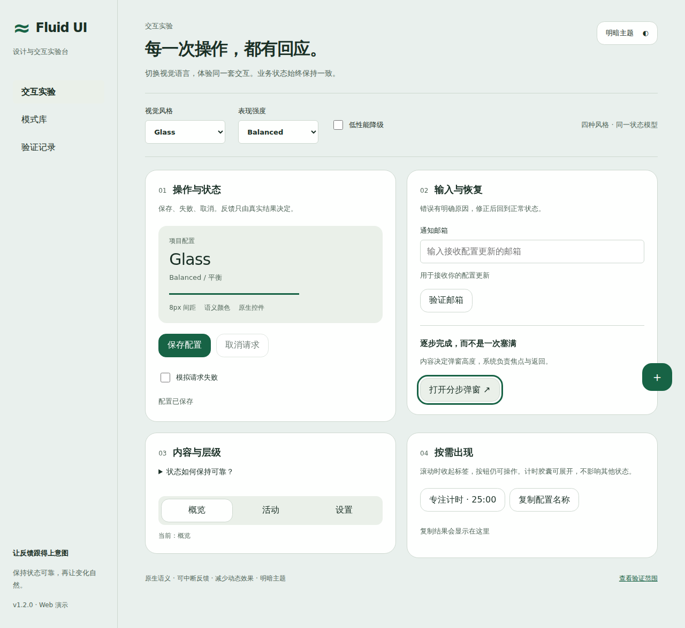
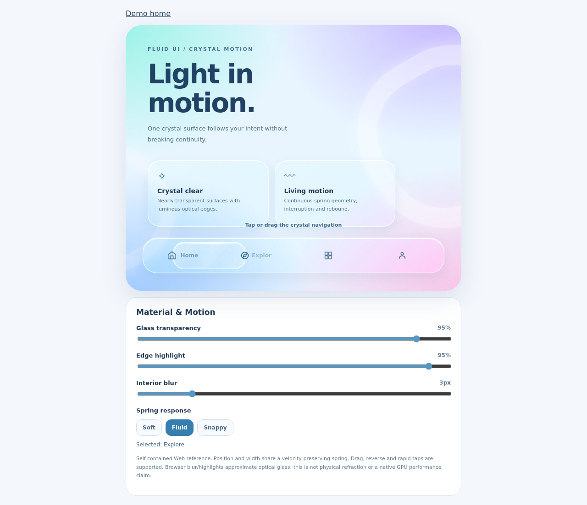
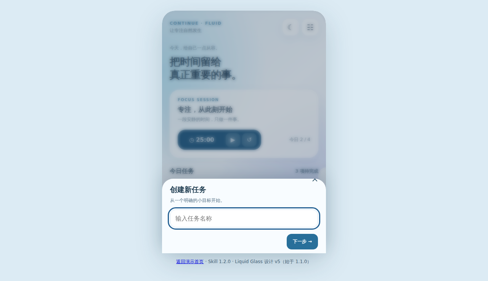

# 已实现演示的真实运行截图

[在线演示站](https://zzm112451.github.io/fluid-ui-skill/) · [验证索引](verification/README.md) · [20 种概念图](SHOWCASE.zh-CN.md)

以下图片由 Chromium 对组装后的 Pages 目录运行 `npm run test:site` 时捕获。它们展示三个不同的实际状态，不是概念图，也不代表全部 20 种模式已实现。

## 交互实验台：Glass 配置保存成功

对应测试先验证失败与取消，再保存成功，并验证分步弹窗打开、Escape 关闭及焦点恢复。

## Crystal Motion：切换到 Explore 的中间态

画面记录 Explore 已被语义选中、透镜仍在移动的转场中间态。后续回归同时等待透镜与选中项对齐后再截图；真机拖动手感与 GPU 性能仍须单独测量。

## Liquid Glass v5：创建任务弹窗

对应测试验证计时器操作可见、创建任务弹窗可打开；完整行为另由浏览器回归套件验证。

复现截图：运行 `npm run test:site`，结果在 `test-results/site/`。提交到本页的截图为人工核查后的快照；最新运行以对应 CI 工件为准。

截图来源：[首轮 Ubuntu 部署回归](https://github.com/ZZM112451/fluid-ui-skill/actions/runs/43556264522/job/132329689871)，提交 `e0b7b908`，2026-11-14，Chromium，1280px 桌面视口。
