# Crystal Motion — 20 Interaction Showcase

[English](../README.md) · [简体中文](SHOWCASE.zh-CN.md) · [Interactive Web reference](../demo/crystal-motion/index.html)

> **Important:** The following SVG images are **individual conceptual illustrations**, not screenshots of 20 running implementations. They show intended appearance only. A visual illustration is not evidence that an interaction works.

The existing Skill includes 20 interaction specifications. Crystal Motion adds material/motion guidance to all 20. Currently the Crystal Motion Web demo provides a runnable shared-lens navigation example and material controls; the other pattern illustrations below do not represent completed Crystal Motion implementations.

| # | Interaction | Preview | Functional acceptance | Verification |
|---|---|---|---|---|
| 1 | [Theme Reveal](../skills/fluid-ui/references/patterns/theme-reveal.md) | 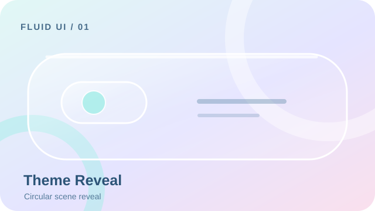 | Bidirectional theme, cancel, reduced motion | Crystal Motion implementation not verified |
| 2 | [Floating Timer Pill](../skills/fluid-ui/references/patterns/floating-timer-pill.md) | 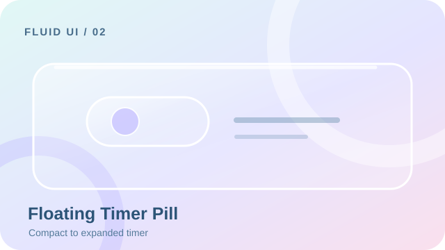 | Timer continuity, pause, background resume | Crystal Motion implementation not verified |
| 3 | [Adaptive Step Sheet](../skills/fluid-ui/references/patterns/adaptive-step-sheet.md) | 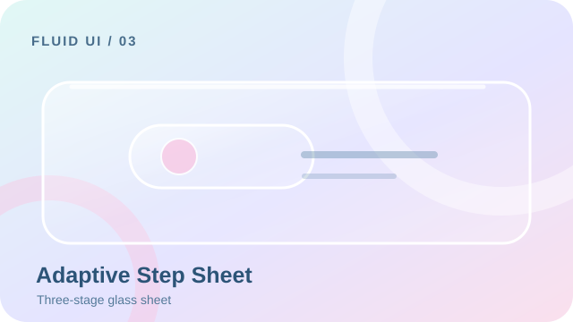 | Validation, keyboard and focus restoration | Crystal Motion implementation not verified |
| 4 | [Fluid Bottom Navigation](../skills/fluid-ui/references/patterns/fluid-bottom-navigation.md) | 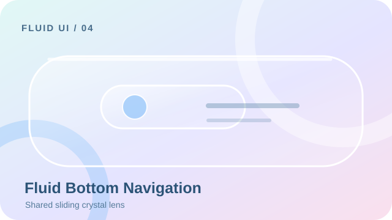 | Rapid reversal, drag, keyboard and shared lens | Automated test added; execution pending |
| 5 | [Scroll-aware FAB](../skills/fluid-ui/references/patterns/scroll-aware-fab.md) | 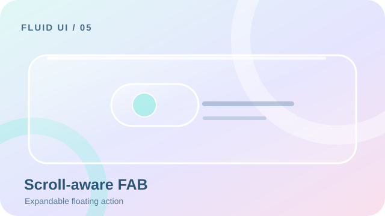 | Scroll thresholds and persistent action target | Crystal Motion implementation not verified |
| 6 | [Copy Success Feedback](../skills/fluid-ui/references/patterns/copy-success-feedback.md) | 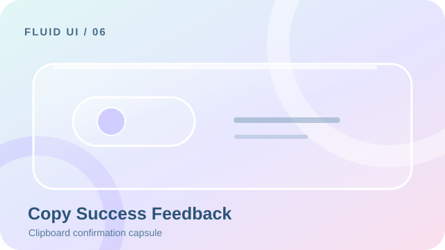 | Clipboard success/failure and stale promises | Crystal Motion implementation not verified |
| 7 | [Animated Form Validation](../skills/fluid-ui/references/patterns/animated-form-validation.md) | 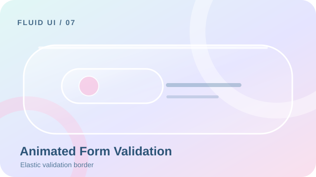 | Error semantics and recovery | Crystal Motion implementation not verified |
| 8 | [Anchored Dropdown](../skills/fluid-ui/references/patterns/anchored-dropdown.md) | 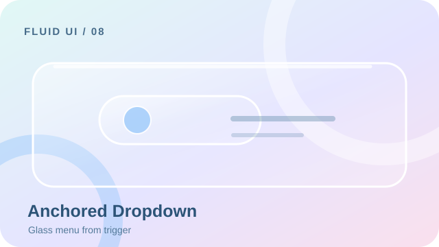 | Escape, focus and anchor placement | Crystal Motion implementation not verified |
| 9 | [Shared Element Transition](../skills/fluid-ui/references/patterns/shared-element-transition.md) | 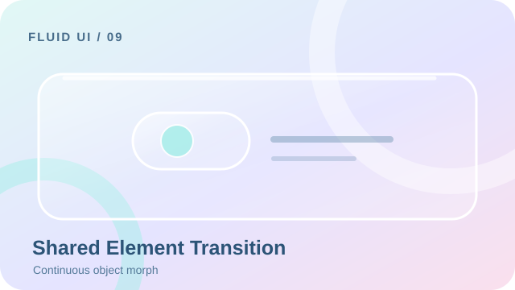 | Reverse navigation and element identity | Crystal Motion implementation not verified |
| 10 | [Expandable Search Field](../skills/fluid-ui/references/patterns/expandable-search-field.md) | 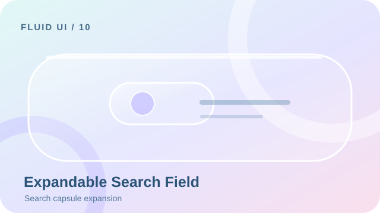 | IME, clear and focus | Crystal Motion implementation not verified |
| 11 | [Elastic Pull to Refresh](../skills/fluid-ui/references/patterns/elastic-pull-to-refresh.md) | 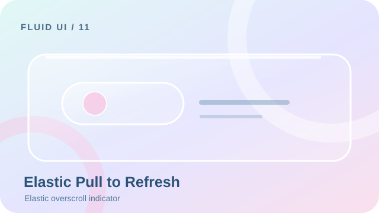 | Threshold, cancel and scrolling | Crystal Motion implementation not verified |
| 12 | [Swipe Actions](../skills/fluid-ui/references/patterns/swipe-actions.md) | 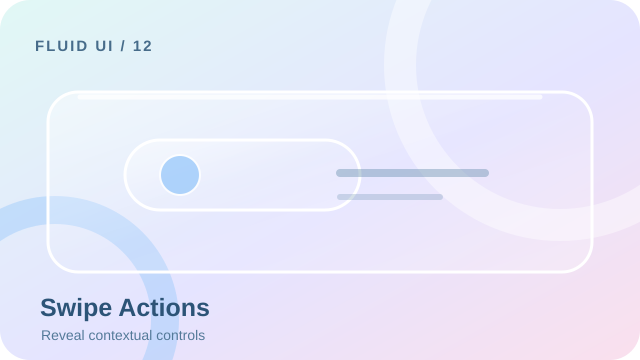 | RTL, cancellation and accidental swipe | Crystal Motion implementation not verified |
| 13 | [Skeleton Content Transition](../skills/fluid-ui/references/patterns/skeleton-content-transition.md) | 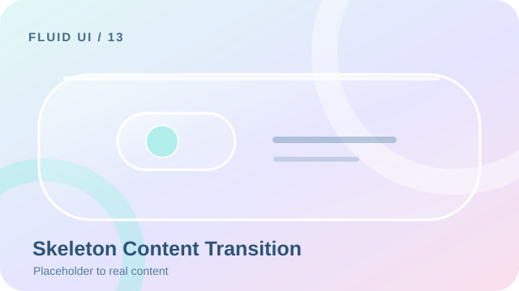 | No layout jump and reduced motion | Crystal Motion implementation not verified |
| 14 | [Reaction Microinteraction](../skills/fluid-ui/references/patterns/reaction-microinteraction.md) | 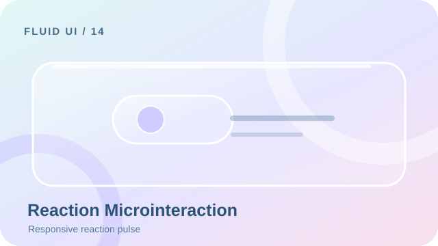 | Repeated taps and accessible state | Crystal Motion implementation not verified |
| 15 | [Async Button States](../skills/fluid-ui/references/patterns/async-button-states.md) | 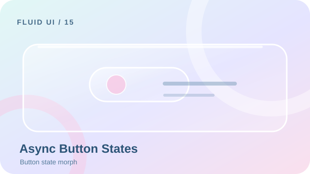 | Loading, error, cancellation and stale response | Crystal Motion implementation not verified |
| 16 | [Immersive Image Preview](../skills/fluid-ui/references/patterns/immersive-image-preview.md) | 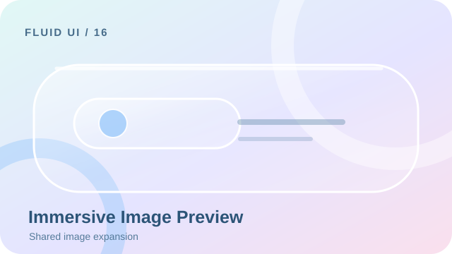 | Zoom, back and dismissal | Crystal Motion implementation not verified |
| 17 | [Predictive Back Transition](../skills/fluid-ui/references/patterns/predictive-back-transition.md) |  | System gesture cancellation | Crystal Motion implementation not verified |
| 18 | [Empty and Error States](../skills/fluid-ui/references/patterns/empty-and-error-states.md) | 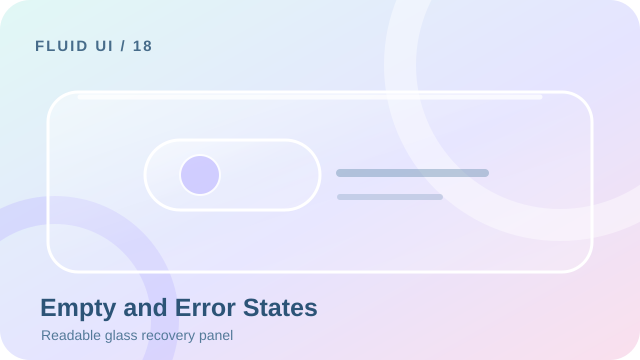 | Offline, retry and semantics | Crystal Motion implementation not verified |
| 19 | [Expandable Content Card](../skills/fluid-ui/references/patterns/expandable-content-card.md) | 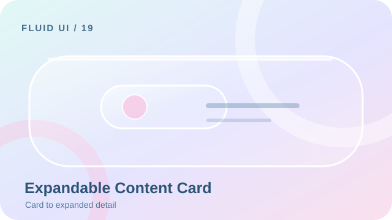 | Dynamic height and interruptions | Crystal Motion implementation not verified |
| 20 | [Collapsing Top App Bar](../skills/fluid-ui/references/patterns/collapsing-top-app-bar.md) | 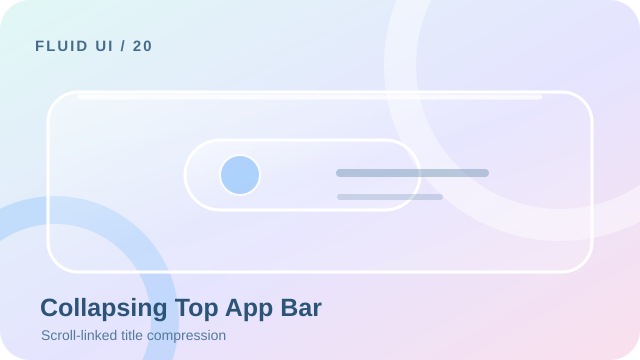 | Safe area and large text | Crystal Motion implementation not verified |

## Verification protocol

1. Implement the pattern on its target platform using the original state contract plus the [Crystal Motion overlay](../skills/fluid-ui/references/presets/crystal-motion.md).
2. Record initial, 25%, 50%, final and reversed states using actual browser/device captures, not generated artwork.
3. Test touch, pointer, keyboard, reduced motion, high contrast, dynamic text and narrow screens as applicable.
4. Test error, cancellation, repeated input, asynchronous races and lifecycle cleanup.
5. Record actual command, environment, pass/fail, captured evidence and unverified platforms. Replace **concept** labels only after real capture.

Do not claim 20 independently verified components from these images.
