# Crystal Motion · 20 种交互效果展示

[English](SHOWCASE.md) · [返回中文介绍](../README.zh-CN.md)

> 所有图片均为**单独制作的概念示意图**，不是 20 种已运行交互的真实截图；图片不代表可用性已经通过验证。

## 1. Theme Reveal

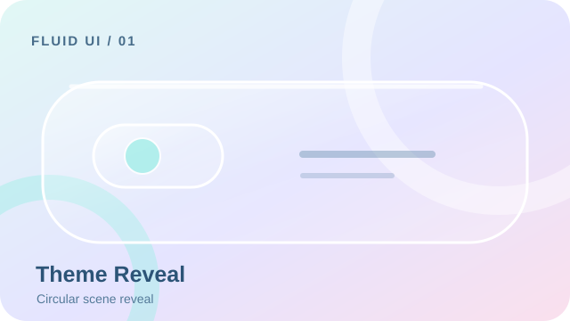

**验收重点：** Bidirectional theme, cancel, reduced motion。

**验证状态：** 尚未完成 Crystal Motion 专项工程验证。

## 2. Floating Timer Pill

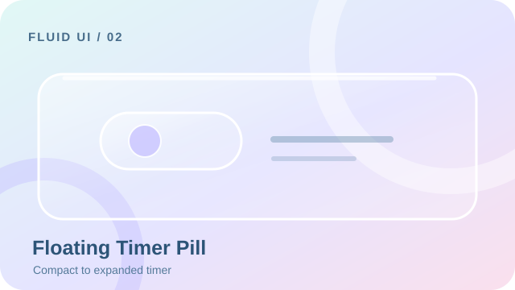

**验收重点：** Timer continuity, pause, background resume。

**验证状态：** 尚未完成 Crystal Motion 专项工程验证。

## 3. Adaptive Step Sheet

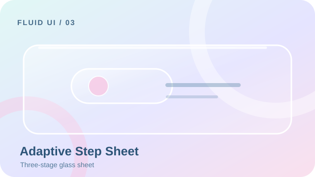

**验收重点：** Validation, keyboard and focus restoration。

**验证状态：** 尚未完成 Crystal Motion 专项工程验证。

## 4. Fluid Bottom Navigation

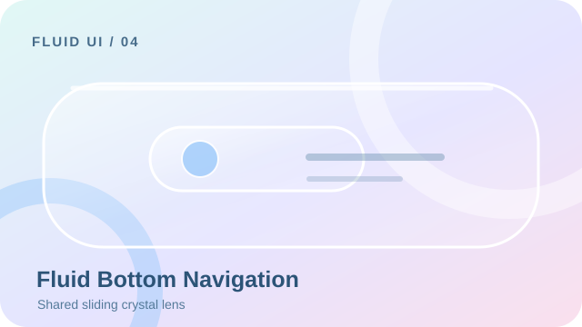

**验收重点：** Rapid reversal, drag, keyboard and shared lens。

**验证状态：** 已添加自动化测试，尚待执行。

## 5. Scroll-aware FAB

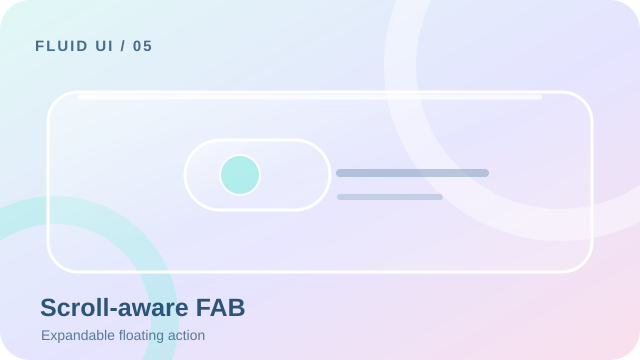

**验收重点：** Scroll thresholds and persistent action target。

**验证状态：** 尚未完成 Crystal Motion 专项工程验证。

## 6. Copy Success Feedback

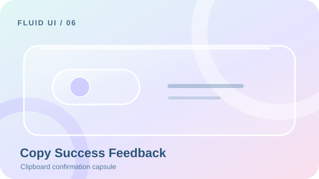

**验收重点：** Clipboard success/failure and stale promises。

**验证状态：** 尚未完成 Crystal Motion 专项工程验证。

## 7. Animated Form Validation

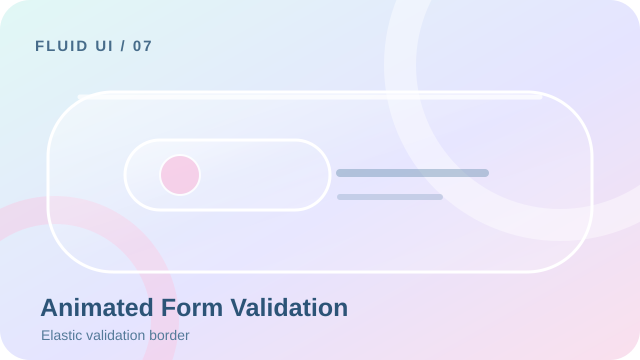

**验收重点：** Error semantics and recovery。

**验证状态：** 尚未完成 Crystal Motion 专项工程验证。

## 8. Anchored Dropdown

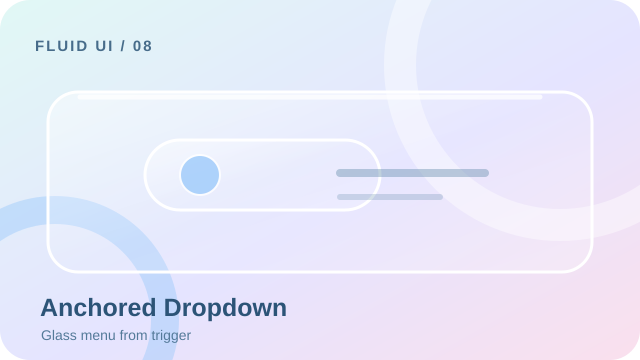

**验收重点：** Escape, focus and anchor placement。

**验证状态：** 尚未完成 Crystal Motion 专项工程验证。

## 9. Shared Element Transition

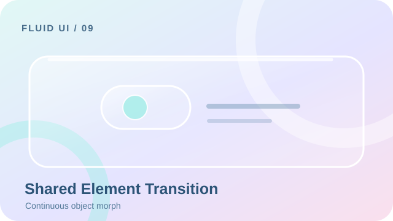

**验收重点：** Reverse navigation and element identity。

**验证状态：** 尚未完成 Crystal Motion 专项工程验证。

## 10. Expandable Search Field

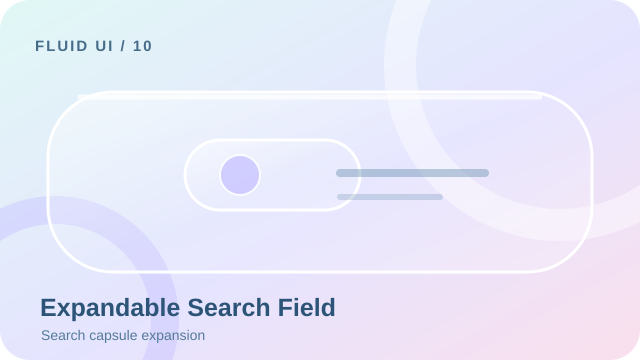

**验收重点：** IME, clear and focus。

**验证状态：** 尚未完成 Crystal Motion 专项工程验证。

## 11. Elastic Pull to Refresh

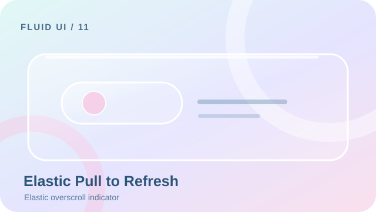

**验收重点：** Threshold, cancel and scrolling。

**验证状态：** 尚未完成 Crystal Motion 专项工程验证。

## 12. Swipe Actions

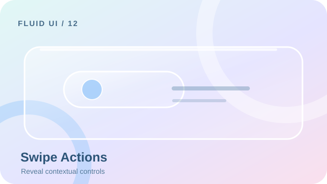

**验收重点：** RTL, cancellation and accidental swipe。

**验证状态：** 尚未完成 Crystal Motion 专项工程验证。

## 13. Skeleton Content Transition

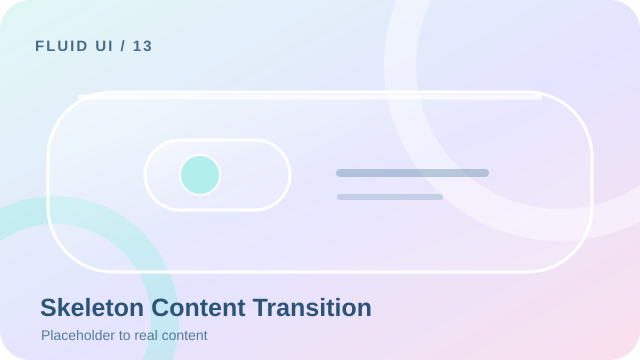

**验收重点：** No layout jump and reduced motion。

**验证状态：** 尚未完成 Crystal Motion 专项工程验证。

## 14. Reaction Microinteraction

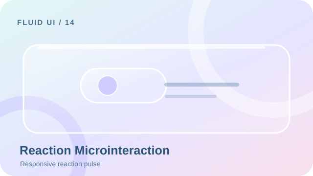

**验收重点：** Repeated taps and accessible state。

**验证状态：** 尚未完成 Crystal Motion 专项工程验证。

## 15. Async Button States

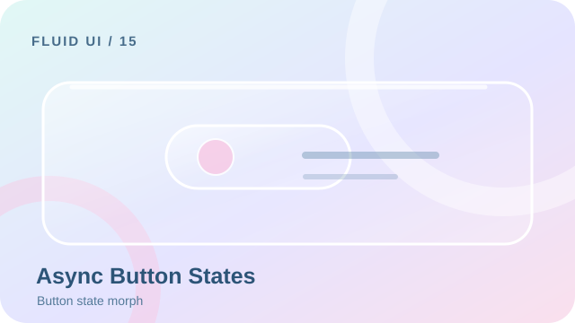

**验收重点：** Loading, error, cancellation and stale response。

**验证状态：** 尚未完成 Crystal Motion 专项工程验证。

## 16. Immersive Image Preview

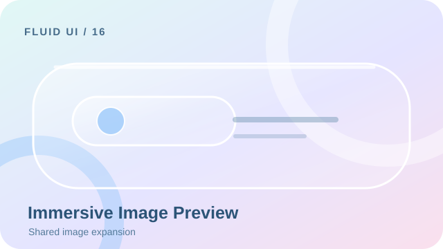

**验收重点：** Zoom, back and dismissal。

**验证状态：** 尚未完成 Crystal Motion 专项工程验证。

## 17. Predictive Back Transition

**验收重点：** System gesture cancellation。

**验证状态：** 尚未完成 Crystal Motion 专项工程验证。

## 18. Empty and Error States

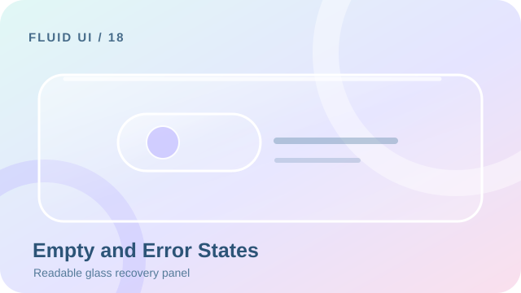

**验收重点：** Offline, retry and semantics。

**验证状态：** 尚未完成 Crystal Motion 专项工程验证。

## 19. Expandable Content Card

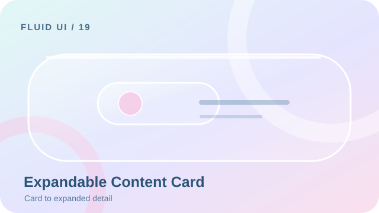

**验收重点：** Dynamic height and interruptions。

**验证状态：** 尚未完成 Crystal Motion 专项工程验证。

## 20. Collapsing Top App Bar

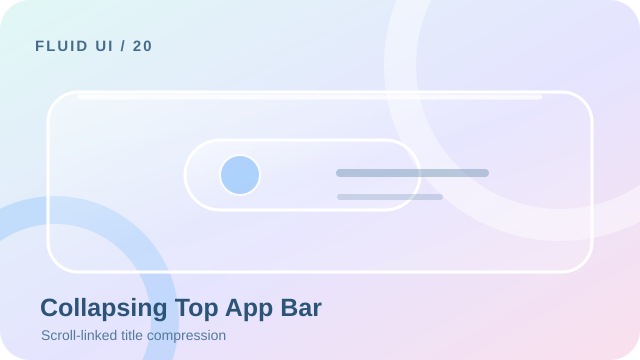

**验收重点：** Safe area and large text。

**验证状态：** 尚未完成 Crystal Motion 专项工程验证。

详细验证步骤见 [英文验收协议](SHOWCASE.md)。
